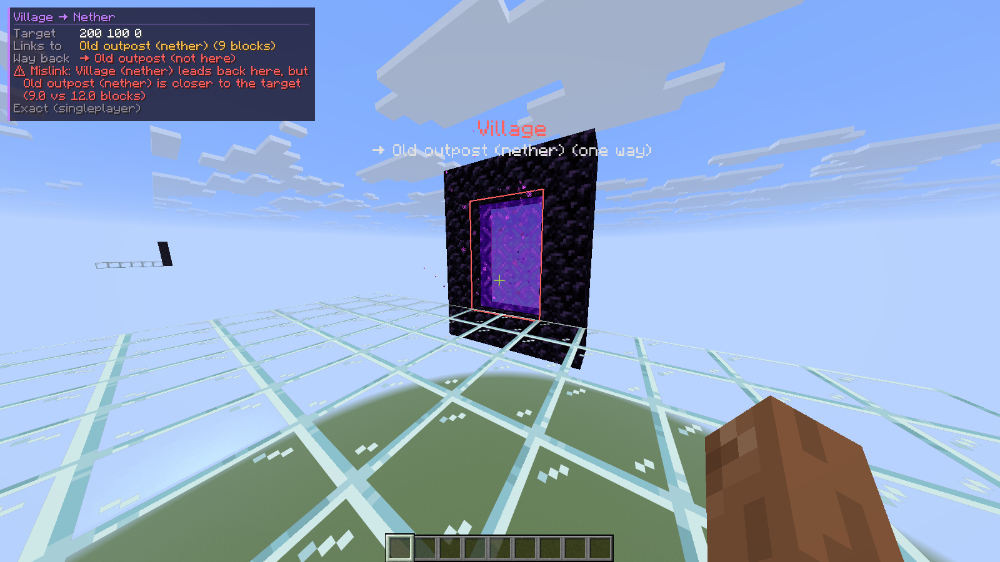

# Waygate

Client-side nether portal planner for Minecraft 26.3 (Fabric). See where a portal leads **before you
step in**, which portal it will link to, whether the way back returns to the same portal, and where to
build a partner so the pair links both ways. No server mod, no packets of its own.



## Use

- **Portal panel** (top left) while you stand in or look at a portal: the target in the other dimension,
  the portal it links to (or "new portal near x y z"), the way back, and warnings:
  - **Mislink**: a portal that would lead back here exists, but another one is closer to the target.
  - **Way back** in red: the linked portal sends you to a different portal.
  - **Part of this portal leads elsewhere**: a wide portal reaches different exits from its two sides
    (one nether block is 8 overworld blocks).
  - **Tie**: two portals at exactly the same distance; the game picks by save order.
  - **Target moved inside the world border.**
- **U** switches the panel: auto (at a portal) / always (also where your own spot leads) / off.
- **Markers**: remembered portals within 64 blocks get an outline and a label: green = links both ways,
  red = one way, purple = no partner yet.
- `/waygate plan` — where to build the partner of the portal you stand in or look at (or, without one,
  a portal where you stand); `/waygate plan x y z [x|z]` for a portal you have not built yet. Says
  whether the pair would link both ways and which known portals would get in the way.
- `/waygate name <name>`, `/waygate unname` — name the portal you stand in or look at.
- `/waygate list` — remembered portals of this world; `/waygate pairs` — every portal with its link
  and whether it works both ways.
- `/waygate forget here|all`, `/waygate config` (also in Mod Menu), `/waygate help`.

Settings are in `config/waygate/config.json`, remembered portals in
`config/waygate/portals/<world>/<dimension>.json`.

## Singleplayer and multiplayer

- **Singleplayer / LAN host**: exact. Waygate reads the built-in server's portal data, so it also knows
  portals you never saw, each dimension's scale and world border, and, when the target area is loaded,
  exactly where a new portal would be built. It never loads or generates chunks.
- **Multiplayer**: the client only knows portals in chunks it has loaded, so Waygate remembers every
  portal you have seen, per server and dimension. Predictions say "remembered portals only": a portal
  you never saw can still win. Where a new portal would be built depends on terrain the client does not
  have, so Waygate gives the spot it will be near (within 16 blocks).

## How the game links portals (26.3)

Read from the game's code, not from older wikis:

- Target: your exact position × the dimension scale (overworld 1, nether 8, or a datapack's
  `coordinate_scale`), x and z clamped to the other dimension's world border. Y is not scaled or clamped.
- Search: every nether portal block within a square of 16 blocks (to the nether) or 128 blocks (to the
  overworld) around the target, at any height. The closest block by 3D distance wins; on equal distance
  the lower one.
- No portal found: a new one is built at the nearest suitable spot within 16 blocks, or on an obsidian
  platform at Y 70 or higher (nether: at most 118).
- The nether leads to the overworld; every other dimension leads to the nether.

See [PLAN.md](PLAN.md) for the full rules and the code they come from.

## Build

Needs JDK 25.

```
./gradlew build          # jar in build/libs, runs the JUnit tests
./gradlew runClient
```

### In-game self-test

```
./gradlew runServer      # run-server/: offline, port 25566, RCON 25576 (password waygatetest)
./gradlew runClient -Pselftest=portals --args="--username WaygateTester --quickPlayMultiplayer 127.0.0.1:25566"
./gradlew runClient -Pselftest=portals --args="--username WaygateTester --quickPlaySingleplayer <world>"
```

It builds a fresh set of portals in both dimensions (a working pair, a mislink, a one-way return and a
portal without partner), walks the player through each one and checks that the server sends the player
where Waygate predicted. It logs `SELFTEST PASS` or `SELFTEST FAIL` and quits. `tools/m*.txt` and
`tools/gallery.txt` are scripted checks and screenshots (`-Pdevscript=...`).

## License

MIT
